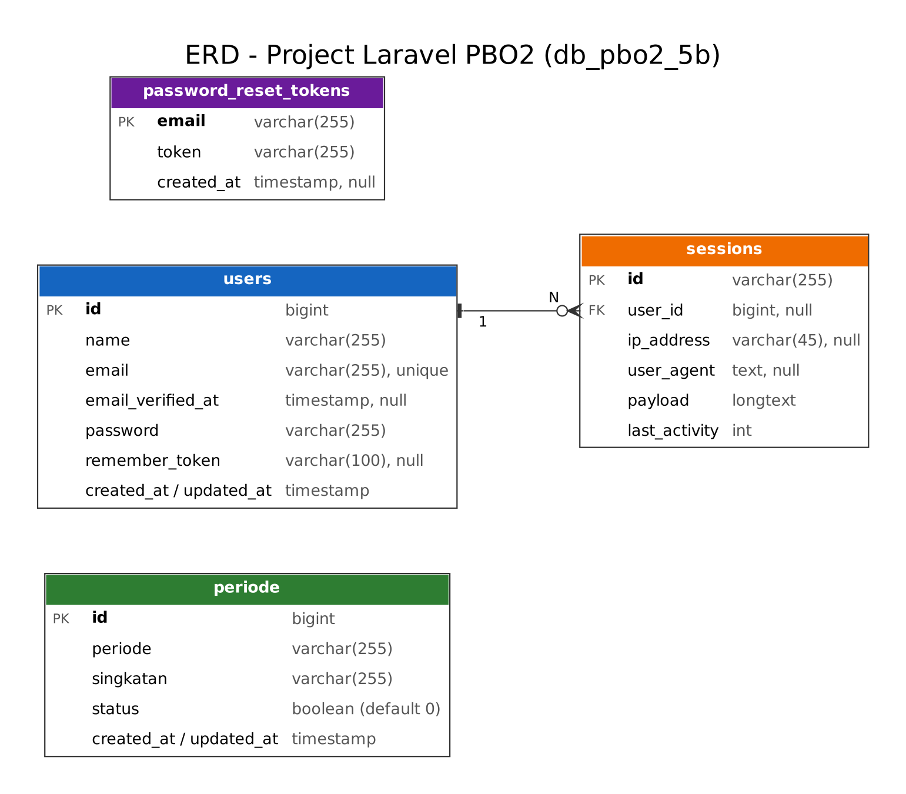

# PBO2 - Project Laravel: CRUD Periode

Project Laravel mengikuti panduan dosen (repo `mirzayogy/laravel5b`): template AdminLTE 4, model + migration + seeder + resource controller, dan laporan PDF (Html2Pdf). CRUD Periode (tambah, ubah, hapus) dilengkapi dengan validasi dan notifikasi.

## Fitur
- Data Periode: lihat, tambah, ubah, hapus
- Validasi form dan pesan sukses/gagal
- Cetak laporan periode ke PDF

## Rancangan Basis Data (ERD)


## Cara Menjalankan

Syarat: PHP 8.4+ (sesuai `composer.lock`), Composer, MySQL (XAMPP/Laragon), Node.js (opsional).

```bash
composer install
cp .env.example .env
php artisan key:generate
```

Buat database kosong `db_pbo2_5b` di phpMyAdmin, lalu:

```bash
php artisan migrate:fresh --seed
php artisan serve
```

Buka http://127.0.0.1:8000
